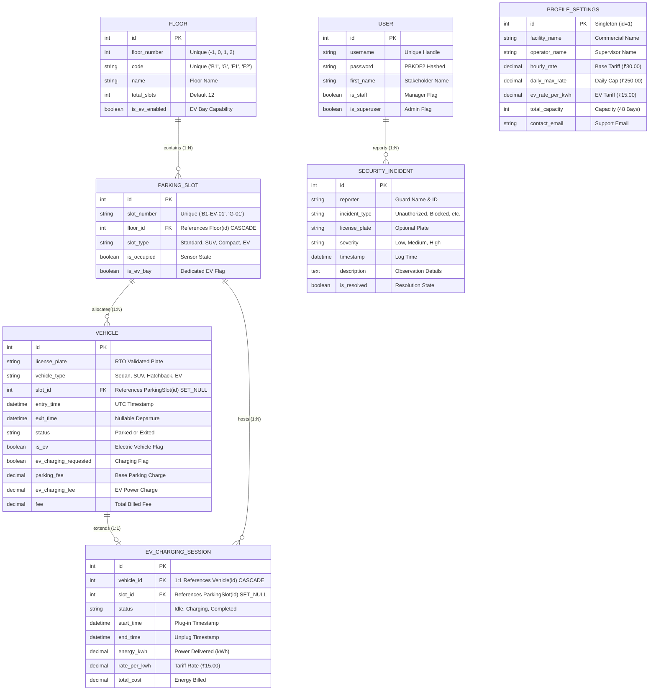

# ParkSmart Pro Enterprise: Complete Project Presentation & Defense Guide
## BBAT104: Fundamentals of Total Quality Management (TQM)
* **Topic Allotment:** Digit 8 &rarr; Parking Management System  
* **Quality Target:** Q08 &rarr; Improve User Satisfaction  
* **Student Name:** Harshit Bhatt | **Roll No:** `2410302018` | **Branch:** CSE [AI & ML]  
* **Institution:** Amrapali University, Haldwani, Uttarakhand  
* **Generated PowerPoint File:** [`ParkSmart_Pro_Enterprise_Presentation.pptx`](file:///F:/TQM/Parking_Management_System_tqm/ParkSmart_Pro_Enterprise_Presentation.pptx)

---

# 📑 Slide-by-Slide Content & Speaker Defense Notes

---

## 🖥️ SLIDE 1: Title Slide (Hero Dark Navy)
* **Slide Title:** **ParkSmart Pro Enterprise**
* **Subtitle:** Commercial Multi-Level Car Parking Automation & EV Fast Charging Management System
* **Context:** BBAT104: Fundamentals of Total Quality Management (TQM) | Digit 8 Allotment
* **Presenter Credentials:**
  * **👤 Presenter:** Harshit Bhatt
  * **Roll Number:** `2410302018` (Digit 8 Allotment)
  * **Branch:** Computer Science & Engineering [AI & ML]
  * **Quality Target:** Q08 &rarr; Improve User Satisfaction
  * **Institution:** Amrapali University, Haldwani (Session 2026–27)
* **Key Commercial Badges:**
  * 👥 5 Stakeholder Portals (Admin, Manager, Operator, Guard, Customer)
  * 🏢 4-Level Car Parking (48 Bays: B1, G, F1, F2)
  * ⚡ EV Fast Charging Hub (7.2 kW AC Smart Chargers + Telemetry)
  * 🛡️ Poka-Yoke Indian License Plate Validation Engine

> **🎙️ Speaker Talking Points:**  
> *"Good morning respected Professor and evaluators. Today I am presenting ParkSmart Pro Enterprise. As per my course allotment for Digit 8 under BBAT104, my focus is Quality Target Q08: Improving User Satisfaction and space utilization. Rather than building a flat academic prototype, we have built a commercial-grade, multi-stakeholder facility platform modeled on real-world systems like FlashParking and TIBA."*

---

## 🖥️ SLIDE 2: Problem Statement & Industrial Motivation
* **Slide Title:** Why Academic Toy Parking Systems Fail in Commercial Operations
* **Four Core Operational Failures:**
  1. **Gate Ingress Queuing Bottlenecks:** Manual paper ticketing and verification cause queues of 8–15 cars spilling onto main campus access roads (45–60s per vehicle).
  2. **Flat vs. Multi-Level Vacuum:** Flat 1-floor software cannot represent physical multi-level garages (Basement, Ground, Level 1, Rooftop), leaving operators blind to multi-tier capacity.
  3. **Unregulated EV Charging Influx:** Modern facilities must handle Electric Vehicles; legacy software lacks charging telemetry, bay reservations, or combined energy billing.
  4. **Human Data Entry Typos:** Careless operator typos corrupt vehicle databases (e.g., entering non-existent district numbers like `UK-87`) without automated Poka-Yoke checks.

> **🎙️ Speaker Talking Points:**  
> *"In real facilities, parking is not a flat 20-slot lot. A modern parking garage has multiple physical building levels, dedicated EV charging bays, and multiple staff tiers. Academic projects fail because they lack mistake-proofing and multi-level tracking. ParkSmart Pro eliminates these bottlenecks from the ground up."*

---

## 🖥️ SLIDE 3: Quality Objectives Aligned with TQM Principles
* **Slide Title:** Quality Objectives Aligned with Core TQM Principles (Q08 Focus)
* **Four TQM Pillars:**
  1. **Poka-Yoke Zero Defects (Shigeo Shingo):** Eliminating human data entry defects at the source via strict Indian RTO boundary validation.
  2. **Role Segregation & Security (ISO 9001):** Distinct, secure workstations for 5 stakeholders with zero unauthorized privilege crossover.
  3. **Visual Management (Andon):** Real-time 4-floor bay occupancy visualizer, capacity heatmaps, animated EV battery charging gauges, and barrier status actuators.
  4. **Deming PDCA Kaizen Cycle:** Plan-Do-Check-Act governance achieving sub-10s gate ingress and automated daily billing ceilings (₹250/day max).

> **🎙️ Speaker Talking Points:**  
> *"TQM is not just drawing a chart; it is embedding quality directly into the product architecture. Our Poka-Yoke engine catches errors before they touch the database, Andon visual management provides live bay feedback, and Deming's continuous cycle enforces standardized pricing."*

---

## 🖥️ SLIDE 4: System Architecture & Modern Tech Stack
* **Slide Title:** Full-Stack Enterprise Architecture & Technology Stack
* **Four Architectural Pillars:**
  * **Backend Framework:** Django 5.x + Python 3.11 with Model-View-Template (MVT) pattern, custom `@require_role` RBAC decorator, and RESTful AJAX validation endpoints.
  * **Relational Database:** SQLite3 in ACID-compliant mode with cascade and set-null foreign key protections and atomic fee transactions.
  * **Poka-Yoke Validation Layer:** `rto_validator.py` with compiled regular expressions, 14+ Indian State/UT district range registries, and debounced keystroke AJAX checks.
  * **Presentation & UX:** Bootstrap 5.3 + Responsive CSS3 grid, dynamic context-aware navbar (`auth_role_context`), Google Plus Jakarta Sans typography, and dual persistent dark/light theming.

```
+-----------------------------------------------------------------------------+
|                             USER INTERFACE LAYER                            |
|             Landing Portal  |  Operator  |  Security  |  Manager  |  Driver |
+-----------------------------------------------------------------------------+
                                      |
                                      v
+-----------------------------------------------------------------------------+
|                        CONTEXT PROCESSOR & RBAC LAYER                       |
|           auth_role_context  |  @require_role Decorator Security            |
+-----------------------------------------------------------------------------+
                                      |
                                      v
+-----------------------------------------------------------------------------+
|                     APPLICATION CONTROLLERS & POKA-YOKE                     |
|           views.py  |  rto_validator.py Engine  |  forms.py Forms           |
+-----------------------------------------------------------------------------+
                                      |
                                      v
+-----------------------------------------------------------------------------+
|                         DATABASE & PERSISTENCE LAYER                        |
|       Floor  |  ParkingSlot  |  Vehicle  |  EVChargingSession  |  Incidents  |
+-----------------------------------------------------------------------------+
```

---

## 🖥️ SLIDE 5: The 5 Stakeholder Workstations Ecosystem
* **Slide Title:** Multi-Tenant Operational Ecosystem & Workstation Roles
* **The 5 Stakeholders:**
  1. **👑 Admin / Owner (`/admin-console/`):** Full facility oversight, staff accounts, database diagnostics, and gross revenue reconciliation.
  2. **💼 Operations Manager (`/manager/`):** Multi-floor capacity heatmaps, hourly parking tariffs, EV kWh pricing, and revenue analytics.
  3. **🚗 Gate Operator / Cashier (`/operator/`):** High-speed check-in with Poka-Yoke verification, multi-floor bay allotment, checkout billing, and 80mm thermal receipt.
  4. **🛡️ Security Guard (`/security/`):** Simulated Ingress/Egress boom barrier actuators, live plate scanner lookup, security incident dispatch, and resolution feed.
  5. **🚙 Customer / Driver (`/customer/`):** "Find My Car" locator, bay walking directions, live floor vacancy explorer, real-time EV battery gauge, and e-receipt download.

> **🎙️ Speaker Talking Points:**  
> *"When a facility operates, the Security Guard needs barrier controls and incident logging, the Operator needs rapid vehicle check-in, the Manager needs financial tariffs, and the Customer needs to find their car. Having a single screen for everyone is unrealistic; ParkSmart Pro provides purpose-built workstations for every persona."*

---

## 🖥️ SLIDE 6: Stakeholder 1 — 👑 Admin & Owner Console
* **Slide Title:** 👑 Admin / Owner Console — Executive Governance & Health HQ
* **Endpoint:** `/admin-console/` & `/admin/`
* **Credentials:** `admin` / `admin123`
* **Key Capabilities:**
  * **Staff Account Management:** Directory of all registered stakeholder accounts with permissions and workstation shortcuts.
  * **Database Health Counters:** Live monitoring of active staff accounts (6), managed bays (48), total vehicle transactions (45+), and security logs (4).
  * **System Diagnostic Audit:** Framework version, database integrity, validation layer status, and building specifications.
  * **Django Superuser Admin Link:** One-click shortcut into Django's low-level admin registry (`/admin/`).
  * **Database Re-Seed Engine:** Built-in administrative tool to purge and regenerate clean commercial demo datasets (`/api/reset-seed/`).

---

## 🖥️ SLIDE 7: Stakeholder 2 — 💼 Operations Manager Console
* **Slide Title:** 💼 Operations Manager Console — Financial Analytics & Tariff Control
* **Endpoint:** `/manager/`
* **Credentials:** `manager` / `manager123`
* **Key Capabilities:**
  * **Separated Revenue Analytics:** Real-time financial telemetry distinguishing base parking turnover from EV power sales.
  * **Multi-Floor Capacity Heatmaps:** Visual horizontal progress bars tracking occupancy across Level B1, Ground, F1, and F2 with automatic warning thresholds (>85% switches to red).
  * **Live Tariff & Pricing Form:** Live configuration of base hourly parking rate (₹30.00/hr), daily ceiling cap (₹250.00/day), and EV fast charging tariff (₹15.00/kWh).
  * **Recent Departure Stream:** Real-time log of departing vehicles with duration and invoice summaries.

---

## 🖥️ SLIDE 8: Stakeholder 3 — 🚗 Gate Operator / Cashier Terminal
* **Slide Title:** 🚗 Gate Operator / Cashier Terminal — Ingress & POS Cashier Station
* **Endpoint:** `/operator/`
* **Credentials:** `operator` / `operator123`
* **Key Capabilities:**
  * **Multi-Floor Visual Grid:** Tabbed bay visualizer across B1, G, F1, F2 showing vacant (green), occupied (red), and EV charging (cyan) bays.
  * **Poka-Yoke Check-In Modal (<kbd>Alt+N</kbd>):** Rapid vehicle registration with real-time keystroke RTO validation and automatic bay routing.
  * **Smart Floor Routing:** Arriving EVs are automatically routed to Level B1; SUVs to Ground floor; standard cars across F1/F2.
  * **Instant Checkout & Billing:** One-click departure checkout computing billed duration, daily cap protection, and EV energy fees.
  * **80mm POS Thermal Receipt:** Generates printable tax invoices with barcode, duration breakdown, and GST details.

---

## 🖥️ SLIDE 9: Stakeholder 4 — 🛡️ Security Guard Console
* **Slide Title:** 🛡️ Security Guard Console — Boom Barrier Controls & Gate Patrol
* **Endpoint:** `/security/`
* **Credentials:** `guard` / `guard123`
* **Key Capabilities:**
  * **Remote Boom Barrier Actuators:** Manual override switches to Raise/Lower North Ingress and South Egress boom barriers with session state persistence.
  * **ANPR Guard Plate Scanner:** Instant plate lookup verifying whether an approaching car is actively registered, its allotted bay, or an unauthorized visitor.
  * **Security Incident Dispatch Form:** Digital logging form categorizing security issues (Unauthorized Parking, Blocked Lane, Suspicious Vehicle, Barrier Gate Issue) with severity flags (Low, Medium, High).
  * **Live Incident Feed & Resolution:** Patrol log stream with severity badges and 1-click "Resolve" button.
  * **Strict Role Isolation:** Security guards cannot access Operator, Manager, or Admin consoles.

---

## 🖥️ SLIDE 10: Stakeholder 5 — 🚙 Customer / Driver Portal
* **Slide Title:** 🚙 Customer / Driver Portal — "Find My Car" & Live EV Telemetry
* **Endpoint:** `/customer/`
* **Access:** Public / Guest Driver or `customer`
* **Key Capabilities:**
  * **"Find My Car" Search Engine:** Motorists enter their license plate (e.g., `UK-04-EV-2024` or `uk04ak5521`) to locate their parked vehicle.
  * **Bay & Floor Navigation:** Displays allotted bay code (e.g. `B1-EV-01`) and floor name (`Basement Level B1`) with pedestrian guidance.
  * **Live Parked Duration & Fee Meter:** Shows live elapsed time and real-time accrued parking charges.
  * **Animated EV Battery Gauge:** Custom visual battery graphic displaying real-time charging status, battery percentage (e.g. 78%), and energy delivered (kWh).
  * **Multi-Floor Vacancy Explorer:** 4 visual cards displaying live available vs total slots for public drivers looking for open bays.

---

## 🖥️ SLIDE 11: Entity-Relationship (ER) Diagram & Database Architecture
* **Slide Title:** Entity-Relationship (ER) Diagram & Relational Schema Architecture

### Mermaid ER Diagram:



---

## 🖥️ SLIDE 12: Poka-Yoke Indian License Plate & RTO Validation Engine
* **Slide Title:** Poka-Yoke RTO License Plate Validation Engine (`rto_validator.py`)
* **Core Mistake-Proofing Flow:**
  1. **Sanitization:** Cleans characters, strips spaces/hyphens, and uppercases string.
  2. **Regex Syntax Check:** Enforces standard Indian format `^([A-Z]{2})(\d{1,2})([A-Z]{0,3})(\d{1,4})$`.
  3. **State Code Check:** Validates against official 14+ Indian States and Union Territories (`UK`, `DL`, `UP`, `HR`, `MH`, `PB`, `RJ`, `KA`, `MP`, `GJ`, `TN`, `WB`, etc.).
  4. **Strict RTO District Range Verification:**
     * **Uttarakhand (`UK`):** Strictly enforces district codes between `01` and `20` (`UK-01` Almora &rarr; `UK-20` Ranikhet).
     * **Rejection of `UK-87`:** Entering `UK-87` triggers immediate rejection:  
       > *"Poka-Yoke Error Prevention: 'UK-87' is an invalid RTO registration. Uttarakhand RTO district codes strictly range from UK-01 to UK-20 (UK-87 does not exist)."*
     * **Acceptance of `UK-04`:** Entering `uk04ak5521` validates as *Uttarakhand (Nainital / Haldwani RTO)* and normalizes to `UK-04-AK-5521`.
  5. **Real-Time Keystroke Feedback:** The check-in modal queries `/api/validate-plate/?plate=...` on keystroke with debouncing.

---

## 🖥️ SLIDE 13: 4-Level Multi-Floor Car Parking Architecture
* **Slide Title:** 4-Level Multi-Floor Car Parking Architecture (48 Bays)
* **Floor Breakdown:**
  * **Level 2 (F2) — Covered Rooftop (12 Bays: `F2-01` to `F2-12`):** Standard Sedans (`F2-01` to `F2-06`) and Compact City Cars (`F2-07` to `F2-12`). Weather-protected covered rooftop structure.
  * **Level 1 (F1) — First Floor Deck (12 Bays: `F1-01` to `F1-12`):** Dedicated to Standard Sedans and Hatchbacks with direct egress ramp access.
  * **Ground Floor (G) — Ingress Level (12 Bays: `G-01` to `G-12`):** Heavy SUV & Premium Bays (`G-01` to `G-06`) + Standard Sedans (`G-07` to `G-12`). Reinforced floor slab for oversized vehicles.
  * **Basement (B1) — EV Charging Hub (12 Smart Bays: `B1-EV-01` to `B1-EV-12`):** 100% Dedicated Electric Vehicle (EV) Fast Charging Hub equipped with virtual 7.2 kW AC chargers & telemetry.
* **Smart Routing Intelligence:** Arriving EVs are automatically routed to Level B1; SUVs to Ground floor; standard cars across F1/F2. Non-EVs are blocked from reserving EV bays.

---

## 🖥️ SLIDE 14: EV Smart Fast Charging Infrastructure & Telemetry
* **Slide Title:** EV Fast Charging Station Telemetry & Combined Billing
* **Key Features:**
  * **12 Dedicated Bays:** Basement Level B1 is 100% reserved for Electric Vehicles.
  * **Telemetry Telemetry:** Tracks charging status (`Idle` &rarr; `Actively Charging` &rarr; `Fully Charged 100%`), energy delivered in kWh, and charging duration.
  * **Dynamic Battery Gauge:** Custom visual battery graphic displaying real-time battery percentage ($35\% \rightarrow 100\%$) based on energy delivered.
  * **Combined Billing Mathematics:**
    $$\text{Total Invoice} = \text{Parking Fee} + \text{EV Energy Sales}$$
    $$\text{Parking Fee} = (\text{Days} \times \text{Daily Cap}) + \min(\text{Daily Cap}, \text{Hours} \times \text{Hourly Rate})$$
    $$\text{EV Energy Sales} = \text{Energy Consumed (kWh)} \times \text{EV Tariff Rate (₹15.00/kWh)}$$
  * **Live Example:** Vehicle `UK-04-EV-2024` parked 3 hours with 20.0 kWh delivered:
    * Parking Fee: $3\text{h} \times ₹30 = ₹90.00$
    * EV Power Charge: $20\text{ kWh} \times ₹15 = ₹300.00$
    * Net Invoice Billed: $₹390.00$

---

## 🖥️ SLIDE 15: Commercial POS Checkout & 80mm Thermal Tax Invoice
* **Slide Title:** Commercial POS Checkout & 80mm Thermal Tax Invoice (`receipt.html`)
* **Key Capabilities:**
  * **Automated Duration Timestamping:** Computes exact stay duration upon departure without human calculation disputes.
  * **Daily Maximum Ceiling Protection:** Capped at ₹250.00/day to eliminate runaway multi-day billing disputes.
  * **Itemized Charge Breakdown:** Separates base parking duration, EV energy kWh, included GST (18%), and net payable.
  * **Print-Optimized Thermal Layout:** Built strictly to 80mm POS printer specifications (380px centered) with `@media print` CSS hiding browser chrome.
  * **Barcode & QR Verification:** Encodes invoice serial number and vehicle license plate for automated gate exit scanner clearance.

---

## 🖥️ SLIDE 16: Security & Role-Based Access Control (RBAC) Enforcement
* **Slide Title:** Strict Role-Based Access Control (RBAC) & Session Defense
* **Key Security Implementations:**
  1. **Elimination of Auto-Login Bypass:** Clicking stakeholder cards opens an interactive credential verification modal; password entry is strictly required.
  2. **Server-Side `@require_role` Decorator:** Protects `/admin-console/`, `/manager/`, `/operator/`, `/security/`. Unauthorized access triggers a `403 Access Denied` alert and bounces the user to their authorized home console.
  3. **Prevention of Cross-Role Escalation:** A logged-in Security Guard cannot access the Admin Console or Manager Ops (even via URL bar tampering).
  4. **Context-Aware Dynamic Navbar:** Templates render only links authorized for the active user role; unauthenticated visitors see zero internal terminal links.
  5. **Explicit Role Sign-Out:** Session switcher requires authenticating with the destination role's credentials to switch accounts.

---

## 🖥️ SLIDE 17: Live Verification, Test Suite & Commercial Dataset
* **Slide Title:** Test Suite Execution & Pre-Seeded Commercial Dataset
* **Automated Unit Test Suite (`tests.py`):**
  * `test_poka_yoke_rto_validator`: Verifies rejection of UK-87 and normalization of UK-04.
  * `test_unauthenticated_workstation_access_blocked`: Guarantees unauthenticated access is rejected.
  * `test_guard_cannot_access_admin_or_manager`: Proves RBAC isolation blocks guard from admin/manager consoles.
  * `test_admin_supervisory_access`: Verifies admin executive privileges.
  * `test_credential_authentication_flow`: Verifies password verification and rejection of invalid passwords.
  * `test_poka_yoke_check_in_rejection_in_form`: Ensures operator form blocks invalid plates.
  * `test_valid_check_in_and_smart_slot_allocation`: Verifies bay allocation logic.
  * `test_ev_fast_charging_and_billing`: Verifies EV session & combined fee calculation.
  * `test_api_validate_plate`: Verifies AJAX keystroke validation endpoint.
* **Test Suite Result:** `Ran 9 tests in 7.194s — OK (0 Failures, 0 Errors)`.
* **Pre-Seeded Database (`seed_multi_floor.py`):** 4 Floors, 48 Slots, 12 Active Parked Cars, 4 Active EV Charging Sessions, 33 Departed Vehicles, 4 Security Logs, and 6 Stakeholder Accounts.

---

## 🖥️ SLIDE 18: Conclusion, TQM Defense & Key Achievements
* **Slide Title:** Commercial Quality & Syllabus Compliance
* **Key Summary Points:**
  * **100% BBAT104 Syllabus Compliance:** Digit 8 allotment strictly implemented; all 5 Q08 Quality Goal features operating at production level.
  * **Commercial SaaS Transformation:** Eliminated academic toy clutter; delivered enterprise UI matching real platforms (FlashParking, TIBA).
  * **5 Dedicated Stakeholder Workstations:** Fully realized operational portals for Admin, Operations Manager, Gate Operator, Security Guard, and Customer.
  * **Industrial Poka-Yoke RTO Protection:** Hard-rejection of invalid district codes (e.g. UK-87) with real-time keystroke feedback.
  * **EV Charging Hub & 4-Level Architecture:** Seamless 4-floor car parking with virtual 7.2 kW EV fast charging, battery telemetry, and 80mm POS billing.
  * **Zero Security Bypasses & Strict RBAC:** Complete elimination of auto-login vulnerabilities; strict `@require_role` enforcement and isolated navbars.

---

# 🎯 Professor Defense Q&A Preparation

### Q1: "Why did you remove the Statistical Quality Control (SQC) Pareto and Fishbone charts from the web app?"
> **Your Answer:**  
> *"Sir, in real commercial parking operations (such as shopping malls, airports, and corporate complexes), gate operators, security guards, and customers should never see internal academic engineering diagrams on their operational screens. A cashier's job is sub-10 second check-in, and a guard's job is barrier security. We transformed the platform into a true enterprise SaaS system with real-time operational telemetry—such as live multi-floor capacity heatmaps, EV power delivery tracking, and boom barrier overrides. We continue to document the TQM principles (Poka-Yoke, PDCA, Crosby Zero Defects) in our technical project report and presentation slides, where they belong."*

### Q2: "Explain how your Poka-Yoke engine works on license plate entry."
> **Your Answer:**  
> *"Poka-Yoke means mistake-proofing at the source, pioneered by Shigeo Shingo. In traditional software, if an operator enters an invalid plate like `UK-87-XXXX`, the database blindly accepts it, causing revenue and law enforcement audit issues. In ParkSmart Pro, our `rto_validator.py` engine checks the state code and cross-references official Regional Transport Office district boundaries. In Uttarakhand, valid RTO district codes strictly range from `UK-01` (Almora) to `UK-20` (Ranikhet). Because `UK-87` does not exist, the system rejects it immediately with an informative alert, both on keystroke in the UI and during server-side form submission. Conversely, valid entries like `uk04ak5521` are recognized as Nainital/Haldwani and normalized to `UK-04-AK-5521`."*

### Q3: "How does your system enforce security if a Security Guard tries to access the Admin console?"
> **Your Answer:**  
> *"We implemented strict server-side Role-Based Access Control (RBAC). In `views.py`, every workstation is protected by our `@require_role` decorator. If a user logged in as `guard` attempts to navigate to `/admin-console/` or `/manager/`, the server intercepts the request before view execution, returns a 403 Security Policy denial, flashes an Access Denied message, and redirects the guard back to their authorized Security Gate workstation. Furthermore, our `base.html` navbar uses a dynamic context processor (`auth_role_context`) to hide all unauthorized links, ensuring complete interface isolation."*

### Q4: "How does the EV charging integration calculate fees?"
> **Your Answer:**  
> *"Level B1 is a dedicated EV Fast Charging Hub with 12 smart bays. When an EV is parked, the system initiates an `EVChargingSession` and tracks power transfer (simulated at 7.2 kW charging speed) and battery percentage ($35\% \rightarrow 100\%$). Upon checkout, our billing algorithm calculates a unified invoice: base parking hours at ₹30/hour (protected by a ₹250/day ceiling cap to prevent billing disputes) plus EV energy sales at ₹15/kWh. The cashier and customer receive an itemized 80mm thermal tax invoice showing exact duration, power delivered, and included 18% GST."*
